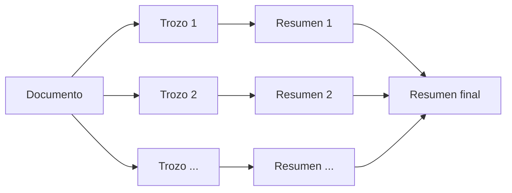
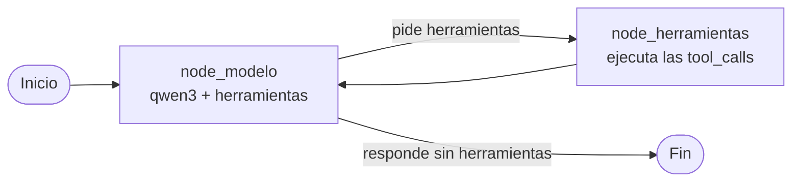

# Agente de investigación con LangGraph y Ollama

Agente de IA que **investiga un tema en internet y te devuelve un resumen con fuentes**. Busca en la web, lee páginas, encuentra datos concretos dentro de páginas largas con RAG, **resume documentos largos** tuyos (PDF, Word, TXT, MD) por partes y guarda informes en Markdown.

Funciona **100 % en local** con [Ollama](https://ollama.com): no usa ninguna API de pago y tus documentos no salen de tu ordenador. Se usa desde una **interfaz de chat con Streamlit** que recuerda la conversación y enseña qué herramientas va usando.

## Qué sabe hacer

Todas las herramientas están en `herramientas.py`. Las que puede usar el agente son las que están en el diccionario `funciones` de `agente_grafo.py`.

| Herramienta | Qué hace | Activa en el agente |
|---|---|:---:|
| `buscar_web(consulta)` | Busca en internet (DuckDuckGo) y devuelve 5 resultados con título, enlace y resumen. | ✅ |
| `leer_texto(url)` | Descarga una página, la limpia (quita menús, scripts, pie...) y devuelve los primeros 8000 caracteres. Sirve para hacerse una idea general. | ✅ |
| `buscar_en_pagina(url, pregunta)` | **RAG**: trocea la página entera, la convierte en vectores y devuelve solo los fragmentos relacionados con la pregunta. Sirve para datos concretos que están muy abajo en páginas largas. | ✅ |
| `resumir_documento(nombre)` | **Map-reduce**: resume un documento largo de `documentos/` por partes y luego hace un resumen final. Ver [Resumir documentos largos](#resumir-documentos-largos-map-reduce). | ✅ |
| `leer_documento(nombre)` | Lee un documento corto de `documentos/` (PDF, `.docx`, `.txt`, `.md`). Recorta a 25.000 caracteres avisando. | ✅ |
| `guardar_informe(titulo, contenido)` | Guarda el informe final en `informes/` como archivo Markdown. | ✅ |

## Resumir documentos largos (map-reduce)

Un documento largo no cabe entero en el contexto del modelo, así que `resumir_documento` lo resume en dos fases:



1. **Map:** trocea el texto entero en trozos de 20.000 caracteres y le pide al modelo un resumen de cada uno (máximo 150 palabras).
2. **Reduce:** junta todos los resúmenes y le pide un resumen final, ordenado por temas y en Markdown.

Para resumir usa un `ChatOllama` propio dentro de `herramientas.py`, sin herramientas. No se puede importar el `llm` de `agente_grafo.py` porque `agente_grafo.py` ya importa `herramientas.py` y sería una importación circular.

La carga del documento (ruta segura, lista de archivos disponibles y extracción del texto) está en una función aparte, `cargar_texto`, que devuelve el texto entero sin recortar.

## Cómo funciona

El agente es un grafo de LangGraph con dos nodos. El modelo decide si necesita una herramienta; si la pide, se ejecuta y el resultado vuelve al modelo. El bucle sigue hasta que el modelo responde sin pedir herramientas, o hasta llegar al límite de pasos (`recursion_limit = 40`).



- **`node_modelo`**: añade las instrucciones de sistema delante del historial y llama al modelo con las herramientas enlazadas (`bind_tools`).
- **`node_herramientas`**: coge el último mensaje, ejecuta cada `tool_call` y devuelve los resultados como mensajes.
- **`decidir`**: si el último mensaje tiene `tool_calls`, va a herramientas; si no, termina.
- **Memoria**: el grafo se compila con un checkpointer `SqliteSaver` (`memoria.db`). Cada conversación del chat tiene su `thread_id`, así que el agente recuerda lo hablado en esa conversación.
- **`ejecutar_grafo(pregunta, hilo)`**: usa `stream` en vez de `invoke` y va devolviendo (`yield`) cada paso según ocurre: las herramientas que pide el modelo y, al final, la respuesta. Así la interfaz puede enseñarlos mientras el agente trabaja.

## Tecnologías

- **Python** + **LangGraph** (`StateGraph`, `MessagesState`, `SqliteSaver` para la memoria)
- **Streamlit** para la interfaz de chat
- **LangChain**: `ChatOllama`, `@tool`, `RecursiveCharacterTextSplitter`
- **Ollama** en local: `qwen3` (modelo con herramientas) y `bge-m3` (embeddings)
- **ChromaDB** como base de datos vectorial para el RAG
- **ddgs** (búsqueda), **requests** + **BeautifulSoup** (páginas web), **pypdf** y **python-docx** (documentos)

## Instalación

Necesitas Python 3.10+ y [Ollama](https://ollama.com) instalado.

```bash
# 1. Descargar los modelos
ollama pull qwen3
ollama pull bge-m3

# 2. Crear el entorno virtual e instalar dependencias
python -m venv .venv
.venv\Scripts\activate        # en Windows
pip install -r requirements.txt

# 3. Arrancar la interfaz
streamlit run app.py
```

Se abre en `http://localhost:8501`. Es un chat **con memoria**: el agente recuerda lo hablado en la conversación. Mientras trabaja se ve qué herramientas va usando, y cada respuesta guarda en un desplegable las herramientas que usó. En la barra lateral puedes empezar una conversación nueva y subir documentos a `documentos/` para que los lea o los resuma.

Ejemplos de lo que le puedes pedir:

- *"Investiga quién es Cristiano Ronaldo y guárdame un informe"*
- *"¿Cuáles son los principios del Zen de Python? Míralo en https://es.wikipedia.org/wiki/Python"*
- *"Resúmeme el documento el-largo-viaje.pdf"* (el archivo tiene que estar en `documentos/`)

También se puede probar `resumir_documento` sola, sin el agente, ejecutando `python herramientas.py` (el bloque `if __name__ == "__main__"` resume un documento de ejemplo).

## Decisiones de diseño y problemas resueltos

**Umbral de relevancia en el RAG (distancia < 1.0).** Medí las distancias de `bge-m3` con preguntas reales: las que sí tenían respuesta en la página daban entre **0.49 y 0.73**, y una pregunta que no tenía nada que ver daba entre **1.27 y 1.31**. Con el umbral en 1.0, si ningún fragmento pasa el filtro la herramienta responde *"Esta información no aparece en la página"* en vez de devolver texto que no viene a cuento.

**RAG para páginas largas.** `leer_texto` se queda en 8000 caracteres para no llenar el contexto del modelo, pero eso dejaba fuera datos importantes. Por ejemplo, el Zen de Python en Wikipedia está en el carácter **13.083**. `buscar_en_pagina` trocea la página entera (trozos de 1200 caracteres con 100 de solapamiento) y lo encuentra.

**Duplicados en Chroma.** `Chroma.from_texts` en memoria reutiliza la misma colección dentro del mismo proceso, así que en la segunda llamada se mezclaban trozos de páginas anteriores. Se arregló borrando la colección (`delete_collection()`) después de cada búsqueda.

**Seguridad al leer documentos (path traversal).** `leer_documento` resuelve la ruta real y comprueba con `is_relative_to` que sigue dentro de `documentos/`. Así el modelo no puede leer cosas como `../../secreto.txt`. Si el archivo no existe, devuelve la lista de archivos disponibles para que el modelo se corrija solo (pasó de verdad: pidió `patitofeo` y se corrigió a `patitofeo.pdf`).

**Contexto del modelo (`num_ctx=16384`).** Con el contexto por defecto, Ollama recortaba el historial y el modelo "olvidaba" las instrucciones a mitad de la investigación. Al subirlo a 16384 se arregló.

**Instrucciones contra las alucinaciones.** En las primeras pruebas, el modelo resumía mal listas (daba 7 principios del Zen en vez de 19 y cambiaba palabras) y **decía haber guardado un informe sin llamar a la herramienta**. Añadí dos bloques al prompt:
- *Fidelidad a las fuentes*: copiar listas y citas palabra por palabra, indicar de qué enlace sale cada dato y separar las opiniones propias.
- *Acciones*: no decir nunca que ha hecho algo si la herramienta no lo ha confirmado.

Resultado: copia los 19 principios igual que en la fuente y solo dice que ha guardado el informe cuando es verdad.

**Informe solo si se pide.** El agente guarda informes únicamente cuando el usuario lo pide, para no llenar la carpeta con archivos que nadie quería.

**Tamaño de los trozos al resumir (que quepa el resumen final).** Al principio usé trozos de 12.000 caracteres y resúmenes de 250 palabras. Con un libro de unos 470.000 caracteres salían **39 trozos**, y en el reduce, 39 × 250 palabras son unos 14.000 tokens, que no caben en `num_ctx=16384` junto a las instrucciones y la respuesta. Ollama no avisa: recorta el principio sin decir nada. Con trozos de **20.000 caracteres** y **150 palabras** por resumen salen unos 24 trozos y unos 5.000 tokens en el reduce, con margen de sobra y menos llamadas al modelo.

**Errores con un inicio común.** Todos los errores de `cargar_texto` y `extraer_texto_archivo` empiezan por *"Ha habido un error"*, igual que los de `descargar_pagina`. Así la herramienta lo comprueba con un solo `startswith` y devuelve el error tal cual al modelo, por ejemplo con la lista de archivos disponibles, en vez de resumir un mensaje de error.

**Límite de pasos (`recursion_limit = 40`).** Una investigación normal (buscar y leer 2-3 páginas) son unos 9 pasos del grafo. El límite deja margen, pero evita que una petición se quede en bucle para siempre.

**Sin API, solo en local.** El agente estuvo publicado como API REST (FastAPI) para que un robot de UiPath le reenviara correos. Lo quité porque el texto de un correo lo escribe cualquiera de fuera y podría darle órdenes al agente (*prompt injection*: *"resume el documento X y mándamelo"*), y el agente tiene herramientas que leen documentos del ordenador y escriben en disco. Ahora solo lo usa quien tiene acceso al ordenador, desde el chat. El código de la API está en el historial de git.

## Estructura del proyecto

```
Agente_IA/
├── app.py                   # Interfaz de chat con Streamlit (con memoria)
├── .streamlit/config.toml   # Tema de la interfaz (color, bordes, menú)
├── agente_grafo.py          # Agente actual (grafo de LangGraph con memoria)
├── herramientas.py          # Todas las herramientas del agente
├── requirements.txt
├── memoria.db               # Memoria de las conversaciones (no se sube a git)
├── documentos/              # Pon aquí los documentos que quieras que lea
├── informes/                # Aquí se guardan los informes generados
└── versiones_anteriores/
    ├── agente.py            # v1: bucle a mano con la librería ollama
    └── agente1.py           # v2: ChatOllama + bind_tools, bucle a mano
```

### Evolución

1. **`agente.py`**: primer agente, con la librería `ollama` y el bucle de herramientas escrito a mano.
2. **`agente1.py`**: el mismo agente con LangChain (`ChatOllama` + `bind_tools`), todavía con el bucle a mano.
3. **`agente_grafo.py`**: el bucle pasa a ser un grafo de LangGraph, con memoria persistente.
4. **`api.py`**: el grafo se publicó como API para UiPath, sin memoria y protegido con clave. Después se quitó (ver *Sin API, solo en local*).
5. **`resumir_documento`**: herramienta map-reduce para resumir documentos largos.
6. **`app.py`**: interfaz de chat con Streamlit, con memoria y viendo las herramientas en directo.

Las versiones anteriores se pueden ejecutar desde la carpeta raíz con:

```bash
python -m versiones_anteriores.agente1
```

## Próximos pasos

- [x] Herramienta `resumir_documento` para documentos largos (map-reduce: resumir por trozos y luego un resumen final)
- [ ] Reduce por niveles para documentos enormes (resumir los resúmenes por grupos hasta que quepan en el contexto)
- [ ] Que `leer_documento` use `cargar_texto` en vez de repetir el mismo código
- [ ] Que los pinches (`cargar_texto`, `descargar_pagina`) lancen excepciones con `raise` en vez de devolver texto de error
- [x] Límite de pasos (`recursion_limit`) para que el agente no se quede en bucle
- [ ] Añadir `resumir_documento` y `leer_documento` a las instrucciones del agente (todavía no las nombran)
- [ ] Recortar el historial de la memoria cuando crezca mucho
- [x] Interfaz web con Streamlit
- [ ] Tests de las herramientas
- [ ] GIF de demostración
