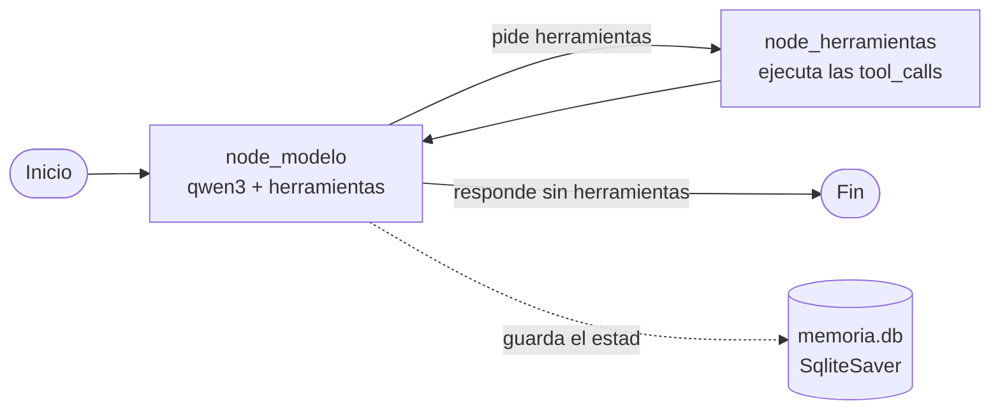

# Agente de investigación con LangGraph y Ollama

Agente de IA que **investiga un tema en internet y te devuelve un resumen con fuentes**. Busca en la web, lee páginas, encuentra datos concretos dentro de páginas largas con RAG, lee tus propios documentos (PDF, Word, TXT, MD) y guarda informes en Markdown.

Funciona **100 % en local** con [Ollama](https://ollama.com): no usa ninguna API de pago y tus documentos no salen de tu ordenador.

## Qué sabe hacer

| Herramienta | Qué hace |
|---|---|
| `buscar_web(consulta)` | Busca en internet (DuckDuckGo) y devuelve 5 resultados con título, enlace y resumen. |
| `leer_texto(url)` | Descarga una página, la limpia (quita menús, scripts, pie...) y devuelve los primeros 8000 caracteres. Sirve para hacerse una idea general. |
| `buscar_en_pagina(url, pregunta)` | **RAG**: trocea la página entera, la convierte en vectores y devuelve solo los fragmentos relacionados con la pregunta. Sirve para datos concretos que están muy abajo en páginas largas. |
| `leer_documento(nombre)` | Lee un documento de la carpeta `documentos/` (PDF, `.docx`, `.txt`, `.md`). |
| `guardar_informe(titulo, contenido)` | Guarda el informe final en `informes/` como archivo Markdown. |

Además, el agente **recuerda las conversaciones** aunque cierres el programa (memoria persistente en SQLite).

## Cómo funciona

El agente es un grafo de LangGraph con dos nodos. El modelo decide si necesita una herramienta; si la pide, se ejecuta y el resultado vuelve al modelo. El bucle sigue hasta que el modelo responde sin pedir herramientas.



- **`node_modelo`**: añade las instrucciones de sistema delante del historial y llama al modelo con las herramientas enlazadas (`bind_tools`).
- **`node_herramientas`**: coge el último mensaje, ejecuta cada `tool_call` y devuelve los resultados como mensajes.
- **`decidir`**: si el último mensaje tiene `tool_calls`, va a herramientas; si no, termina.

## Tecnologías

- **Python** + **LangGraph** (`StateGraph`, `MessagesState`, `SqliteSaver`)
- **LangChain**: `ChatOllama`, `@tool`, `RecursiveCharacterTextSplitter`
- **Ollama** en local: `qwen3` (modelo con herramientas) y `bge-m3` (embeddings)
- **ChromaDB** como base de datos vectorial para el RAG
- **ddgs** (búsqueda), **requests** + **BeautifulSoup** (páginas web), **pypdf** y **python-docx** (documentos)

## Instalación

Necesitas Python 3.10+ y [Ollama](https://ollama.com) instalado.

```bash
# 1. Descargar los modelos
ollama pull qwen3
ollama pull bge-m3

# 2. Crear el entorno virtual e instalar dependencias
python -m venv .venv
.venv\Scripts\activate        # en Windows
pip install -r requirements.txt

# 3. Ejecutar el agente
python agente_grafo.py
```

Ejemplos de lo que le puedes pedir:

- *"Investiga quién es Cristiano Ronaldo y guárdame un informe"*
- *"¿Cuáles son los principios del Zen de Python? Míralo en https://es.wikipedia.org/wiki/Python"*
- *"Resúmeme el documento patitofeo.pdf"* (el archivo tiene que estar en `documentos/`)

## Decisiones de diseño y problemas resueltos

**Umbral de relevancia en el RAG (distancia < 1.0).** Medí las distancias de `bge-m3` con preguntas reales: las que sí tenían respuesta en la página daban entre **0.49 y 0.73**, y una pregunta que no tenía nada que ver daba entre **1.27 y 1.31**. Con el umbral en 1.0, si ningún fragmento pasa el filtro la herramienta responde *"Esta información no aparece en la página"* en vez de devolver texto que no viene a cuento.

**RAG para páginas largas.** `leer_texto` se queda en 8000 caracteres para no llenar el contexto del modelo, pero eso dejaba fuera datos importantes. Por ejemplo, el Zen de Python en Wikipedia está en el carácter **13.083**. `buscar_en_pagina` trocea la página entera (trozos de 1200 caracteres con 100 de solapamiento) y lo encuentra.

**Duplicados en Chroma.** `Chroma.from_texts` en memoria reutiliza la misma colección dentro del mismo proceso, así que en la segunda llamada se mezclaban trozos de páginas anteriores. Se arregló borrando la colección (`delete_collection()`) después de cada búsqueda.

**Seguridad al leer documentos (path traversal).** `leer_documento` resuelve la ruta real y comprueba con `is_relative_to` que sigue dentro de `documentos/`. Así el modelo no puede leer cosas como `../../secreto.txt`. Si el archivo no existe, devuelve la lista de archivos disponibles para que el modelo se corrija solo (pasó de verdad: pidió `patitofeo` y se corrigió a `patitofeo.pdf`).

**Contexto del modelo (`num_ctx=16384`).** Con el contexto por defecto, Ollama recortaba el historial y el modelo "olvidaba" las instrucciones a mitad de la investigación. Al subirlo a 16384 se arregló.

**Instrucciones contra las alucinaciones.** En las primeras pruebas, el modelo resumía mal listas (daba 7 principios del Zen en vez de 19 y cambiaba palabras) y **decía haber guardado un informe sin llamar a la herramienta**. Añadí dos bloques al prompt:
- *Fidelidad a las fuentes*: copiar listas y citas palabra por palabra, indicar de qué enlace sale cada dato y separar las opiniones propias.
- *Acciones*: no decir nunca que ha hecho algo si la herramienta no lo ha confirmado.

Resultado: copia los 19 principios igual que en la fuente y solo dice que ha guardado el informe cuando es verdad.

**Informe solo si se pide.** El agente guarda informes únicamente cuando el usuario lo pide, para no llenar la carpeta con archivos que nadie quería.

## Estructura del proyecto

```
Agente_IA/
├── agente_grafo.py          # Agente actual (LangGraph + memoria persistente)
├── herramientas.py          # Todas las herramientas del agente
├── requirements.txt
├── documentos/              # Pon aquí los documentos que quieras que lea
├── informes/                # Aquí se guardan los informes generados
└── versiones_anteriores/
    ├── agente.py            # v1: bucle a mano con la librería ollama
    └── agente1.py           # v2: ChatOllama + bind_tools, bucle a mano
```

### Evolución

1. **`agente.py`**: primer agente, con la librería `ollama` y el bucle de herramientas escrito a mano.
2. **`agente1.py`**: el mismo agente con LangChain (`ChatOllama` + `bind_tools`), todavía con el bucle a mano.
3. **`agente_grafo.py`**: el bucle pasa a ser un grafo de LangGraph, con memoria persistente.

Las versiones anteriores se pueden ejecutar desde la carpeta raíz con:

```bash
python -m versiones_anteriores.agente1
```

## Próximos pasos

- [ ] Herramienta `resumir_documento` para documentos largos (map-reduce: resumir por trozos y luego un resumen final)
- [ ] Límite de pasos (`recursion_limit`) para que el agente no se quede en bucle
- [ ] Recortar el historial de la memoria cuando crezca mucho
- [ ] Interfaz web con Streamlit
- [ ] Tests de las herramientas
- [ ] GIF de demostración
